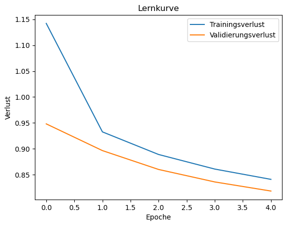
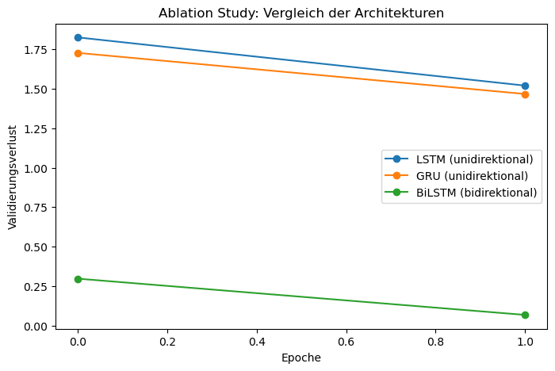

# 🎵 RNN-basierte Musikgenerierung in ABC-Notation

Klassenprojekt im Modul **Deep Learning** (Übungsabgabe 3) von
**Lister Melaguie Doungue** & **Vades Ngounouo Djoko**.

Ein zeichenbasiertes **LSTM-Sprachmodell** (Char-Level) wird auf über 200 000 Musikstücken
in [ABC-Notation](https://abcnotation.com/) trainiert und erzeugt anschließend neue Melodien.
Zur Bewertung dienen Next-Token-Genauigkeit, eine Ablationsstudie (LSTM vs. GRU vs. BiLSTM),
eine regelbasierte Grammatikprüfung und eine eigene Audio-Synthese der generierten Stücke.

---

## 🎯 Ziel

- Musik als Text (ABC-Notation) modellieren und das **nächste Zeichen** vorhersagen
- Mit dem trainierten Modell **neue, plausible Musikstücke generieren** (Temperatur + Top-k-Sampling)
- Die Qualität **quantitativ** (Top-1/Top-5-Accuracy, Perplexity) und **strukturell**
  (Gültigkeit der ABC-Grammatik) bewerten
- Bonus: Architekturen vergleichen und generierte Stücke **hörbar** machen

## 📁 Projektstruktur

```
.
├── rnn.ipynb                 # Finales Notebook mit allen Ausgaben (Training, Generierung, Evaluation, Bonus)
├── rnn_corrige_2.ipynb       # Überarbeitete Variante: DirectML-Versuch (Intel Iris Xe), stride=100, 30 Epochen geplant
├── requirements.txt          # Python-Abhängigkeiten
├── results/
│   ├── Zusammenfassung_RNN_Musikgenerierung.pdf   # Einseitige Projektzusammenfassung
│   ├── best_model.pt                              # Trainierte Gewichte (state_dict, bester Val-Loss)
│   ├── lernkurve.png                              # Trainings- vs. Validierungsverlust
│   ├── ablation_study.png                         # LSTM vs. GRU vs. BiLSTM
│   ├── generated_sample.abc                       # Beispiel einer generierten ABC-Sequenz
│   ├── generated_tune.wav                         # Synthetisierte Audiodatei des generierten Stücks
│   ├── training_log_final.txt                     # Log des finalen Trainings (5 Epochen)
│   └── training_log_rnn_corrige_2.txt             # Log des abgebrochenen Laufs aus rnn_corrige_2.ipynb
└── (train.json, validation.json, …)               # Datensätze – NICHT im Repository, siehe unten
```

## 🛠️ Verwendete Technologien

| Bereich | Werkzeuge |
|---|---|
| Sprache | Python 3 |
| Deep Learning | PyTorch (`nn.Embedding`, `nn.LSTM`, `nn.GRU`, `DataLoader`) |
| Experiment-Tracking | Weights & Biases (W&B) |
| Visualisierung | Matplotlib |
| Audio | Python-Standardbibliothek (`wave`, `struct`, `math`), `IPython.display.Audio` |
| Umgebung | Jupyter Notebook (Anaconda), Training ausschließlich auf CPU |

## 🔬 Vorgehen

1. **Daten laden**: `train.json` (214 122 Stücke) und `validation.json` (2 162 Stücke);
   extrahiert wird jeweils das Feld `abc notation`.
2. **Tokenisierung**: zeichenweise, Vokabular mit **95 Zeichen**.
3. **Dataset**: Fenster der Länge 100, Ziel ist die um ein Zeichen verschobene Sequenz.
   Ein zusätzlicher `stride`-Parameter (hier 1000) erzeugt ca. ein Fenster pro Stück
   (213 076 Trainingsbeispiele). Mit `stride=1` wären es ca. 636 000 Batches pro Epoche gewesen,
   was auf der CPU nicht machbar war.
4. **Modell** (`MusicRNN`):
   `Embedding(95→256)` → `LSTM(256→512, 2 Schichten, Dropout 0.3)` → `Dropout` → `Linear(512→95)`.
   Insgesamt **≈ 3,75 Mio. Parameter**.
5. **Training**: Adam (lr = 1e-3), `ReduceLROnPlateau`, Gradient Clipping (max_norm = 5.0),
   Early Stopping (Patience 3), Batch-Size 128, 5 Epochen (je ca. 42 Min. auf CPU).
6. **Generierung**: Hidden State mit einem Seed aufwärmen, danach autoregressiv mit
   Temperatur 0.9 und Top-k = 20 samplen.
7. **Evaluation**: Top-1- und Top-5-Accuracy der Next-Token-Vorhersage.

## 📊 Ergebnisse

### Trainingsverlauf

| Epoche | Trainingsverlust | Validierungsverlust |
|:-:|:-:|:-:|
| 1 | 1.1420 | 0.9482 |
| 2 | 0.9327 | 0.8966 |
| 3 | 0.8891 | 0.8602 |
| 4 | 0.8610 | 0.8362 |
| 5 | 0.8411 | **0.8186** |



Der Validierungsverlust sinkt in jeder Epoche weiter. Mit mehr Epochen wäre also noch eine Verbesserung zu erwarten.

### Evaluationsmetriken (Next-Token-Vorhersage)

| Metrik | Wert |
|---|---|
| **Top-1 Accuracy** | **73,14 %** |
| **Top-5 Accuracy** | **93,98 %** |
| Ausgewertete Vorhersagen | 214 200 |

> Da kein `test.json` vorlag, wurde auf `validation.json` evaluiert.

### Bonus 1: Ablationsstudie (LSTM vs. GRU vs. BiLSTM)

Kleinere Modelle (Embedding 64, Hidden 128, 2 Epochen) bei sonst gleichen Bedingungen:

| Architektur | Val-Loss | Perplexity |
|---|:-:|:-:|
| LSTM (unidirektional) | 1.5197 | 4.57 |
| GRU (unidirektional) | **1.4667** | **4.33** |
| BiLSTM (bidirektional)\* | 0.0680 | 1.07 |



GRU schneidet leicht besser ab als LSTM.
\*Der sehr niedrige BiLSTM-Verlust ist ein **Data-Leakage-Artefakt**: Das Modell sieht auch den
zukünftigen Kontext und kann deshalb nicht für die autoregressive Generierung genutzt werden.

### Bonus 2: Validity Check (ABC-Grammatik)

Ein regelbasierter Checker prüft balancierte Wiederholungsklammern, korrekte Taktstriche,
ein logisches Ende und erlaubte Zeichen:

| | Ø Validity Score |
|---|:-:|
| Generierte Stücke (n = 3) | 0.47 (0.40–0.60) |
| Echte Trainingsstücke (n = 50, Referenz) | 0.68 |

Die häufigsten Fehler sind unausgeglichene Wiederholungsklammern und ein fehlendes Schlusszeichen.
Hinweis: Die Zeichen-Whitelist stuft Header-Buchstaben (`X`, `L`, `M`, `K`) fälschlich als ungültig ein.
Das ist eine Schwäche des Checkers, kein Fehler des Modells.

### Bonus 3: Programming Creativity (ABC → Audio)

Ein eigener ABC-Parser wandelt Noten und Notenlängen in MIDI-Tonhöhen um. Daraus erzeugt eine
Sinuswellen-Synthese, die nur die Standardbibliothek nutzt, eine abspielbare WAV-Datei
(330 Noten/Pausen): [`results/generated_tune.wav`](results/generated_tune.wav)

### Beispiel einer generierten Melodie

Seed: die ersten 200 Zeichen eines Validierungsstücks. Alles danach hat das Modell erzeugt
(vollständig in [`results/generated_sample.abc`](results/generated_sample.abc)):

```abc
X:1
L:1/8
M:6/8
K:Bb
 F | B2 d c2 f | edc B2 F | GAB cec | BAG FGA | B2 d c2 f | edc B2 F | Gec AGA | B2 d B2 |:
 !fermata!F | D2 F D2 F | EGB cED | C2 E C2 E | DFA Bdf | geg fdb | gab [df]bb | dba ge | dBd cAF | EDE F2 E :: BAB GcB | AGF cAF | BAB dcB | ...
```

## ⚠️ Herausforderungen und Lösungen

- **Keine GPU**: Training nur auf der CPU. Gelöst durch den `stride`-Parameter, der die Zahl der Batches stark reduziert.
  Ein Versuch mit DirectML (Intel Iris Xe) in `rnn_corrige_2.ipynb` scheiterte, weil kein passendes
  `torch-directml`-Paket verfügbar war.
- **W&B 401 CommError**: Ursache war die fehlende `entity` in `wandb.init()`.
- **`wandb.watch()`-Hooks** blieben nach dem Training aktiv und störten die Generierung. Behoben mit `wandb.unwatch(model)`.
- **BiLSTM** zeigt einen scheinbaren Vorteil, der in Wahrheit auf Data Leakage beruht (siehe oben).

## ▶️ Ausführen

```bash
pip install -r requirements.txt
jupyter notebook rnn.ipynb
```

Die Datensätze (`train.json`, `validation.json`, `leadsheet_ids.json`, `variation_ids.json`, `train/*.mid`)
gehören zum Kursmaterial und sind wegen ihrer Größe **nicht im Repository enthalten**. Sie müssen
im Projektverzeichnis neben dem Notebook liegen.

Das Notebook verlangt einen W&B-Login (`WANDB_REQUIRED = True`). Ohne Zugriff auf das Team-Projekt
setzt man `WANDB_REQUIRED = False`.

Vortrainiertes Modell laden:

```python
model = MusicRNN(vocab_size=95, embedding_dim=256, hidden_dim=512, num_layers=2, rnn_type="lstm")
model.load_state_dict(torch.load("results/best_model.pt", map_location="cpu"))
```

> Das Vokabular (`char2idx`) wird im Notebook aus `train.json` aufgebaut (sortierte Zeichenmenge).
> Für die Generierung mit dem gespeicherten Modell braucht man daher denselben Datensatz.

## 👥 Autoren

- Lister Melaguie Doungue
- Vades Ngounouo Djoko
